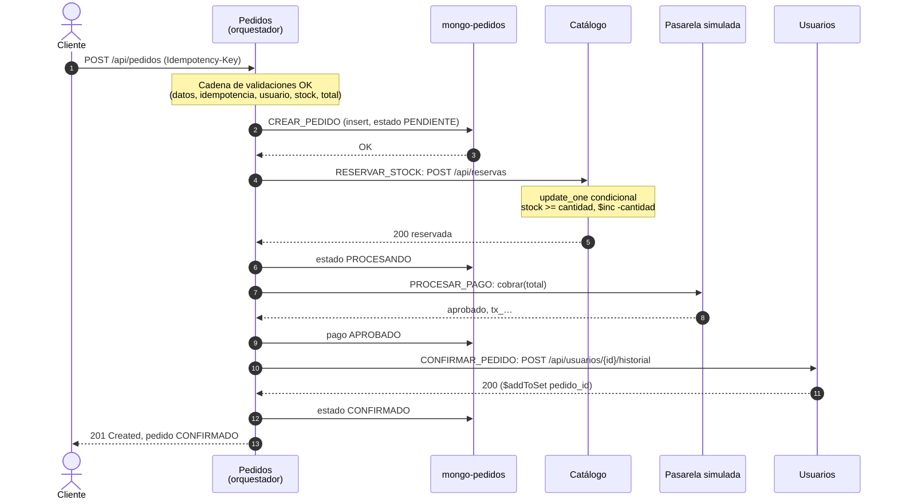
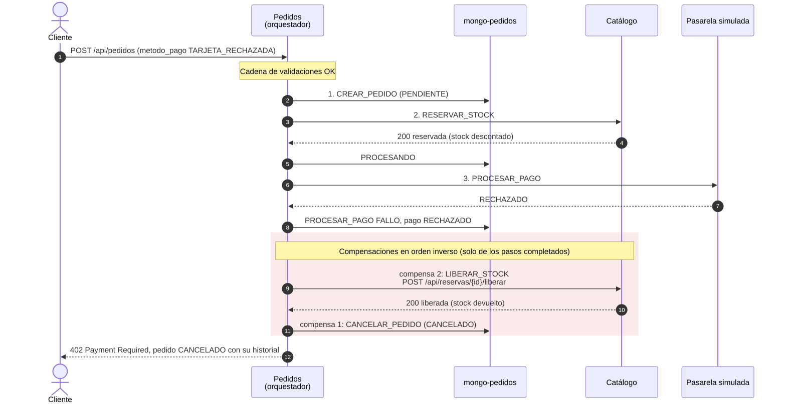
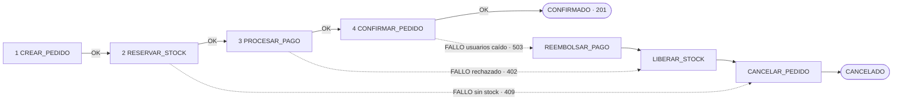
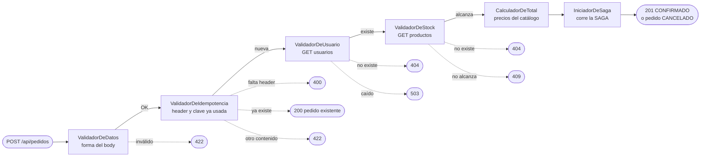

# ShopExpress — Tarea 2, Taller NoSQL 2026

Sistema de microservicios para una plataforma ficticia de comercio electrónico.
Tres servicios en Python (FastAPI), cada uno con su propia base de datos, levantados con Docker Compose.

| Servicio | Puerto | Qué hace | Base de datos | Caché |
|---|---|---|---|---|
| Usuarios | 8001 | Perfiles, direcciones de envío e historial de compras | MongoDB `mongo-usuarios` | Redis `redis-usuarios` |
| Catálogo e Inventario | 8002 | Productos, categorías, precios y stock | MongoDB `mongo-catalogo` | Redis `redis-catalogo` |
| Pedidos y Pagos | 8003 | Pedidos y pagos: orquesta la SAGA y corre la Chain of Responsibility | MongoDB `mongo-pedidos` | — |

## Contenido

1. [Justificación del diseño](#1-justificación-del-diseño)
2. [Diagrama de arquitectura](#2-diagrama-de-arquitectura)
3. [Patrón SAGA](#3-patrón-saga)
4. [Patrón Chain of Responsibility](#4-patrón-chain-of-responsibility)
5. [Endpoints](#5-endpoints)
6. [Estructura de directorios](#6-estructura-de-directorios)
7. [Comandos para construir, levantar y probar](#7-comandos-para-construir-levantar-y-probar)
8. [Event Sourcing, CQRS y privacidad (opcional)](#8-event-sourcing-cqrs-y-privacidad-opcional)
9. [Uso de IA](#9-uso-de-ia)

---

## 1. Justificación del diseño

### 1.1 Requerimientos de consistencia y lectura/escritura

| Operación | Requerimiento de la letra | Prioridad (CAP) | Cómo se logra |
|---|---|---|---|
| Leer usuarios y productos | Extremadamente rápida y escalable | **AP**: disponibilidad, consistencia eventual | Caché en Redis con TTL. Si Redis falla, se lee de Mongo. |
| Escribir pedidos y pagos | Alta consistencia | **CP**: consistencia sobre velocidad | `writeConcern` y `readConcern` `majority`, sin caché. |
| Descontar stock | No puede haber sobreventa | **CP** | Operación atómica condicional en Mongo. Nunca se decide desde la caché. |
| Crear un pedido | Un pedido debe ser único | **CP** | Header `Idempotency-Key` + índice único en Mongo. |

**Lecturas (AP).** Usuarios y catálogo usan Redis con el patrón **cache-aside**: en un `GET` se busca primero en Redis
(`usuario:{id}`, `producto:{id}`). Si no está, se lee de Mongo y se guarda con TTL (60 s usuarios, 30 s catálogo).
Cada escritura invalida la clave. Un dato puede tener hasta ese TTL de atraso: es la consistencia eventual que la letra acepta.
Si Redis se cae, el servicio sigue respondiendo desde Mongo: se pierde velocidad, no disponibilidad.
Las respuestas llevan el header `X-Cache: HIT|MISS` para ver de dónde salió el dato.

**Escrituras (CP).** Pedidos escribe y lee con `majority` y no usa caché: el estado de un pedido se lee siempre actualizado.
Cada Mongo corre como **replica set** (`rs0`), que es lo que habilita `majority` y las transacciones multi-documento.

### 1.2 Bases de datos NoSQL elegidas

Usamos dos bases NoSQL: una **documental** (MongoDB) como base principal de los tres servicios y una **clave-valor en memoria**
(Redis) como caché de lectura de usuarios y catálogo. Cada servicio tiene su propia instancia: ninguno lee ni escribe en la
base de otro, solo se comunican por HTTP.

**MongoDB**, porque:

- Los datos son *agregados* que se leen enteros: un usuario con sus direcciones, un pedido con sus ítems y su pago.
  Un documento guarda cada agregado en una sola lectura, sin joins.
- La consistencia se configura **por operación**: con el mismo motor, pedidos usa `majority` y catálogo descuenta stock
  con una actualización atómica condicional.
- Tiene índices únicos (para el email, el documento y la unicidad del pedido) y transacciones multi-documento.

**Redis**, porque:

- Responde desde memoria: cubre el requerimiento de lecturas "extremadamente rápidas y escalables".
- El TTL nativo acota cuánto tiempo puede estar desactualizado un dato.
- Está configurado solo como caché: sin persistencia en disco y con desalojo LRU.

### 1.3 Modelado de datos: embebido o referencia

| Dato | Decisión | Por qué |
|---|---|---|
| Direcciones del usuario | **Embebidas** en el usuario | Se leen siempre junto con el usuario, son pocas y no tienen sentido solas. |
| Historial de compras | **Referencias**: lista de `pedido_id` | Los pedidos viven en otra base. Se agrega con `$addToSet` para no duplicar ids. |
| Categoría del producto | **Embebida** como texto | No tiene datos propios. |
| Ítems del pedido | **Embebidos**, con **referencia** a `producto_id` | El ítem es parte del pedido; el producto vive en otro servicio. |
| Precio de cada ítem | **Copia** (`precio_unitario`) | Es el precio al momento de comprar: si después cambia en el catálogo, el pedido no cambia. |
| Pago del pedido | **Embebido** | Relación 1 a 1 que siempre se lee y escribe junto con el pedido. |
| Usuario del pedido | **Referencia** (`usuario_id`) | Vive en otro servicio. |

Los IDs son strings con prefijo, como en el anexo de la letra: `usr_…`, `prod_…`, `ord_…`, `tx_…`.

```jsonc
// usuarios
{ "_id": "usr_9369df97f1b3", "tipo_documento": "DNI", "nro_documento": "12345678",
  "nombre": "Juan", "apellido": "Pérez", "email": "juan.perez@example.com",
  "direcciones": [ { "calle": "Av. Principal 123", "ciudad": "Montevideo", "codigo_postal": "11000" } ],
  "historial_pedidos": [ "ord_7eecb86d4e9c" ] }

// productos
{ "_id": "prod_192d47151904", "nombre": "Auriculares inalámbricos",
  "descripcion": "Bluetooth 5.3, 30 horas de batería", "categoria": "Electrónica",
  "precio": 25.5, "stock": 10 }

// pedidos
{ "_id": "ord_7eecb86d4e9c", "usuario_id": "usr_9369df97f1b3", "estado": "CONFIRMADO",
  "items": [ { "producto_id": "prod_192d47151904", "cantidad": 2, "precio_unitario": 25.5 } ],
  "total": 51.0,
  "pago": { "metodo": "TARJETA_CREDITO", "estado_pago": "APROBADO", "transaccion_id": "tx_8d98065b7097" } }
```

Índices únicos: en usuarios, `email` y (`tipo_documento`, `nro_documento`); en pedidos, `idempotency_key`.

### 1.4 Cómo se evita la sobreventa

El stock **nunca se decide desde la caché**. El `GET` de un producto puede mostrar un stock cacheado, que es solo informativo.
La reserva, en cambio, va siempre contra Mongo, con la condición y el descuento en una **sola operación atómica**:

```python
update_one(
    {"_id": producto_id, "stock": {"$gte": cantidad}},   # condición...
    {"$inc": {"stock": -cantidad}},                       # ...y descuento en la misma operación
)
# modified_count == 0  →  no había stock suficiente
```

Si llegan muchas compras a la vez por la última unidad, solo una encuentra `stock >= 1`; para las demás el filtro ya no
coincide y no se modifica nada. No se lee el stock para comparar y después escribir, porque entre esos dos pasos otro
pedido podría llevarse la misma unidad.

Si el pedido tiene varios productos, se reservan **todos o ninguno**: catálogo guarda una reserva por pedido (`_id` = `pedido_id`)
con los productos que ya descontó, y si alguno no tiene stock devuelve exactamente esos. Reservar y liberar se pueden
repetir con el mismo `pedido_id` sin descontar ni devolver de más.

No usamos una transacción multi-documento para esto porque, con muchas compras simultáneas del mismo producto, las
transacciones chocan entre sí y hay que reintentarlas; la actualización condicional resuelve la carrera en una sola operación.

### 1.5 Cómo se garantiza que un pedido sea único

`POST /api/pedidos` exige el header **`Idempotency-Key`**, un id que el cliente genera una vez por compra. Si el mismo
request llega dos veces (doble clic, reintento), no se crea otro pedido ni se cobra de nuevo:

| Caso | Respuesta |
|---|---|
| Falta el header | `400` |
| Ya hay un pedido terminado con esa clave y el mismo contenido | `200` con ese mismo pedido |
| Ya hay un pedido con esa clave que todavía está en proceso | `409` |
| La clave ya se usó con otro contenido | `422` |

La garantía la da el **índice único** sobre `idempotency_key`: si dos requests iguales llegan al mismo tiempo, solo uno logra
insertar el pedido, y al otro se le devuelve el pedido del primero.

---

## 2. Diagrama de arquitectura


- **Una base por servicio.** Cada servicio tiene su propio contenedor de Mongo (y de Redis, si lo usa).
- **Pedidos es el orquestador.** Es el único que llama a los otros dos; usuarios y catálogo no se conocen entre sí.
- **Pago simulado.** No hay pasarela real: la de pedidos aprueba los pagos, salvo el método `TARJETA_RECHAZADA` o un monto
  mayor a 5000, que rechaza para poder mostrar las compensaciones.

---

## 3. Patrón SAGA

El servicio de Pedidos y Pagos es el **orquestador central** ([`saga.py`](servicios/pedidos/app/saga.py)). Ejecuta los pasos en
orden y, si uno falla, ejecuta las **compensaciones de los pasos ya completados, en orden inverso**.
El estado de la saga queda guardado en el propio pedido (`estado` y `historial`).

| # | Paso | Servicio | Qué hace | Compensación si falla un paso posterior |
|---|---|---|---|---|
| 1 | `CREAR_PEDIDO` | pedidos | Guarda el pedido en estado `PENDIENTE` | `CANCELAR_PEDIDO`: estado `CANCELADO` |
| 2 | `RESERVAR_STOCK` | catálogo | Descuenta el stock de todos los productos → `PROCESANDO` | `LIBERAR_STOCK`: devuelve el stock |
| 3 | `PROCESAR_PAGO` | pedidos (pasarela simulada) | Cobra el total → pago `APROBADO` | `REEMBOLSAR_PAGO`: pago `REEMBOLSADO` |
| 4 | `CONFIRMAR_PEDIDO` | usuarios | Agrega el pedido al historial del usuario → `CONFIRMADO` | — (es el último paso) |

Estados del pedido: `PENDIENTE` → `PROCESANDO` → `CONFIRMADO` | `CANCELADO`.

Código HTTP según el paso que falló: `409` sin stock, `402` pago rechazado, `503` servicio caído. En todos los casos la
respuesta trae el pedido `CANCELADO` con su historial, donde se ve en qué paso falló y qué se compensó.

### Transacción exitosa



### Transacción con compensación (pago rechazado)



### Qué se compensa según el paso que falla



Si falla el paso N, se compensan los pasos N-1 … 1. Cuando la reserva responde "sin stock", catálogo ya devolvió lo que
había descontado, así que solo se cancela el pedido.

---

## 4. Patrón Chain of Responsibility

La solicitud de `POST /api/pedidos` pasa por una cadena de manejadores ([`cadena/`](servicios/pedidos/app/cadena/)).
Cada uno hace una sola verificación o cálculo y, si sale bien, le pasa la solicitud al siguiente. Si algo falla, corta la
cadena con un error y los manejadores siguientes no se ejecutan.



| Manejador | Responsabilidad | Corta con |
|---|---|---|
| `ValidadorDeDatos` | Valida el body: `usuario_id`, `items` (al menos uno, cantidad > 0) y `metodo_pago`. | `422` |
| `ValidadorDeIdempotencia` | Exige `Idempotency-Key`. Si ya hay un pedido con esa clave, lo devuelve y termina la cadena. | `400`, `409`, `422` o `200` |
| `ValidadorDeUsuario` | Pregunta al servicio de usuarios si el usuario existe. | `404`, `503` |
| `ValidadorDeStock` | Pregunta al catálogo por cada producto: que exista y que alcance el stock. | `404`, `409`, `503` |
| `CalculadorDeTotal` | Calcula las líneas y el total con los **precios del catálogo**, nunca con los que mande el cliente. | — |
| `IniciadorDeSaga` | Último eslabón: ejecuta la SAGA. | — |

Todos heredan de la clase base [`Manejador`](servicios/pedidos/app/cadena/base.py), con `enlazar()` y `manejar(contexto)`.

**El pago no es un manejador**, aunque la letra menciona `ProcesadorDePago` como ejemplo: es un paso de la SAGA porque
necesita compensación (el reembolso). La cadena solo valida y calcula, sin cambiar nada en otros servicios; los cambios
que hay que poder deshacer los hace la SAGA.

---

## 5. Endpoints

Todos los servicios exponen además `GET /health`.

### Servicio de Usuarios (`localhost:8001`)

#### `POST /api/usuarios` — crea un usuario

```json
{
  "tipo_documento": "DNI",
  "nro_documento": "12345678",
  "nombre": "Juan",
  "apellido": "Pérez",
  "email": "juan.perez@example.com",
  "direcciones": [ { "calle": "Av. Principal 123", "ciudad": "Montevideo", "codigo_postal": "11000" } ]
}
```

`201 Created` con el usuario, su `id` (`usr_…`) y `historial_pedidos: []`.
`409` si el email o el documento ya están registrados, `422` si los datos son inválidos.

#### `GET /api/usuarios/{usuario_id}` — recupera un usuario

`200 OK` con el usuario y el header `X-Cache: MISS` (leído de Mongo) o `HIT` (leído de Redis). `404` si no existe.

#### `GET /api/usuarios/exportar?formato=json|csv` — exporta los usuarios con datos anonimizados

```json
[
  {
    "tipo_documento": "DNI",
    "documento_hash": "97340b8e6c331ef12f5198fbfbffc881a7f6ff7a70430432dd12ffd0adf34d16",
    "email_hash": "1437be8c37ddba4335c050f2bdd509c5a2b8dd5e7a3016da7b028a9e1fc725b4",
    "nombre": "J.",
    "apellido": "P.",
    "direcciones": [ { "ciudad": "Montevideo", "codigo_postal": "11000" } ],
    "cantidad_pedidos": 1
  }
]
```

Con `formato=csv` se descarga como `usuarios.csv`. Ver la [sección 8](#8-event-sourcing-cqrs-y-privacidad-opcional).

### Servicio de Catálogo e Inventario (`localhost:8002`)

#### `POST /api/productos` — crea un producto

```json
{
  "nombre": "Auriculares inalámbricos",
  "descripcion": "Bluetooth 5.3, 30 horas de batería",
  "categoria": "Electrónica",
  "precio": 25.5,
  "stock": 10
}
```

`201 Created` con el producto y su `id` (`prod_…`). `422` si los datos son inválidos.

#### `GET /api/productos/{producto_id}` — recupera un producto y su stock disponible

`200 OK` con el producto y el header `X-Cache: HIT|MISS`. `404` si no existe.

### Servicio de Pedidos y Pagos (`localhost:8003`)

#### `POST /api/pedidos` — inicia la Chain of Responsibility y la transacción SAGA

Header obligatorio: `Idempotency-Key: <id único de la compra>`.

```json
{
  "usuario_id": "usr_9369df97f1b3",
  "items": [ { "producto_id": "prod_192d47151904", "cantidad": 2 } ],
  "metodo_pago": "TARJETA_CREDITO"
}
```

`metodo_pago`: `TARJETA_CREDITO`, `TARJETA_DEBITO`, `TRANSFERENCIA`, o `TARJETA_RECHAZADA` (siempre rechazado, para la demo).

Respuesta `201 Created` (misma estructura que el anexo de la letra, más el historial de la saga):

```json
{
  "pedido_id": "ord_7eecb86d4e9c",
  "usuario_id": "usr_9369df97f1b3",
  "estado": "CONFIRMADO",
  "items": [ { "producto_id": "prod_192d47151904", "cantidad": 2, "precio_unitario": 25.5 } ],
  "total": 51.0,
  "pago": { "metodo": "TARJETA_CREDITO", "estado_pago": "APROBADO", "transaccion_id": "tx_8d98065b7097" },
  "idempotency_key": "compra-7f3a9c",
  "historial": [
    { "paso": "CREAR_PEDIDO",     "resultado": "OK", "detalle": "Pedido creado como PENDIENTE" },
    { "paso": "RESERVAR_STOCK",   "resultado": "OK", "detalle": "Stock reservado en catálogo" },
    { "paso": "PROCESAR_PAGO",    "resultado": "OK", "detalle": "Pago aprobado, transacción tx_8d98065b7097" },
    { "paso": "CONFIRMAR_PEDIDO", "resultado": "OK", "detalle": "Pedido confirmado y agregado al historial del usuario" }
  ]
}
```

Con pago rechazado responde `402` y el pedido `CANCELADO`, con el historial
`CREAR_PEDIDO OK → RESERVAR_STOCK OK → PROCESAR_PAGO FALLO → LIBERAR_STOCK OK → CANCELAR_PEDIDO OK`.
Los demás códigos están en las secciones [1.5](#15-cómo-se-garantiza-que-un-pedido-sea-único) y [4](#4-patrón-chain-of-responsibility).

### Endpoints internos (los usa la SAGA)

| Servicio | Endpoint | Para qué |
|---|---|---|
| catálogo | `POST /api/reservas` | Paso `RESERVAR_STOCK` |
| catálogo | `POST /api/reservas/{pedido_id}/liberar` | Compensación `LIBERAR_STOCK` |
| usuarios | `POST /api/usuarios/{usuario_id}/historial` | Paso `CONFIRMAR_PEDIDO` |
| pedidos | `GET /api/pedidos/{pedido_id}` | Ver un pedido y el estado de su saga |
| pedidos | `GET /api/pedidos/{pedido_id}/eventos` | Ver los eventos de la saga, en orden |

---

## 6. Estructura de directorios

Cada microservicio está en su propio directorio, con su `Dockerfile`:

```
Tarea2-NOSQL/
├── README.md
├── docker-compose.yml              # 3 Mongo (replica set), 2 Redis y los 3 servicios
├── postman/
│   └── ShopExpress.postman_collection.json
├── scripts/
│   ├── prueba_concurrencia.py      # muchos pedidos a la vez contra stock limitado
│   └── demo_sobreventa.py          # lo mismo, directo contra catálogo
└── servicios/
    ├── usuarios/                   # Dockerfile, requirements.txt, app/, tests/
    ├── catalogo/                   # Dockerfile, requirements.txt, app/, tests/
    └── pedidos/                    # Dockerfile, requirements.txt, app/, tests/
        └── app/
            ├── cadena/             # Chain of Responsibility: un archivo por manejador
            ├── saga.py             # orquestador SAGA
            └── pagos.py            # pasarela de pagos simulada
```

---

## 7. Comandos para construir, levantar y probar

Requisitos: Docker con Docker Compose. Para las pruebas por consola, Python 3.12+ y Node.js.

### Construir y levantar

```bash
docker compose up --build -d --wait     # construye las imágenes y espera a que todo esté sano
curl localhost:8001/health              # 8002 catálogo, 8003 pedidos
docker compose down -v                  # bajar todo y borrar los datos
```

### Probar con Postman

La colección [`postman/ShopExpress.postman_collection.json`](postman/ShopExpress.postman_collection.json) prueba todos los casos
en orden. Cada request guarda en variables los ids que usa la siguiente, así que se corre de corrido:

| # | Request | Qué verifica |
|---|---|---|
| 1 | Crear usuario | `201`, id `usr_…`, direcciones embebidas |
| 2.1 / 2.2 | Crear productos (stock 10 y stock 2) | `201`, id `prod_…` |
| 3 | Consultar producto | `200`, stock disponible, header `X-Cache` |
| 4 | Pedido OK | `201`, `CONFIRMADO`, pago `APROBADO`, los 4 pasos de la saga |
| 5 | Pedido sin stock | `409` |
| 6 | Pedido con pago rechazado | `402`, `CANCELADO`, compensaciones en orden inverso |
| 7 | Ver el stock después del rechazo | El stock solo bajó por el pedido OK |
| 8.1 / 8.2 | Exportar usuarios (JSON y CSV) | Datos seudonimizados |

En la app de Postman: **Import** → el archivo `.json` → clic derecho en la colección → **Run collection**.
Por consola:

```bash
npx newman run postman/ShopExpress.postman_collection.json
```

### Otras pruebas

```bash
# tests automáticos (pytest)
pip install -r servicios/usuarios/tests/requirements.txt -r servicios/pedidos/tests/requirements.txt
pytest servicios

# sin sobreventa: con stock 5 y 20 pedidos simultáneos se confirman exactamente 5,
# y el mismo pedido enviado 20 veces a la vez crea uno solo
python scripts/prueba_concurrencia.py
```

---

## 8. Event Sourcing, CQRS y privacidad (opcional)

**Event Sourcing.** Cada paso y cada compensación de la saga se guarda como evento en la colección `eventos` de pedidos.
Los eventos solo se agregan, nunca se modifican, y el pedido y su evento se escriben en una misma transacción. Aplicando los
eventos en orden se reconstruye el pedido (`GET /api/pedidos/{id}/eventos`). Para aplicar Event Sourcing completo, el pedido
se guardaría solo como eventos y su estado actual se calcularía a partir de ellos.

**CQRS.** Separaría el modelo de escritura del de lectura. Ya lo aplicamos en parte: las lecturas salen de Redis y las
escrituras van a Mongo con `majority`. El paso siguiente sería armar, a partir de los eventos, vistas de solo lectura en otra
base (por ejemplo, el historial de compras de cada usuario), que se escalen aparte y tengan consistencia eventual.

**Seudonimización de datos personales.** `GET /api/usuarios/exportar` ([`anonimizacion.py`](servicios/usuarios/app/anonimizacion.py))
devuelve los usuarios sin datos que identifiquen a la persona:

| Dato | Qué se exporta |
|---|---|
| Email y documento | `HMAC-SHA256` con una clave secreta (`CLAVE_SEUDONIMIZACION`) |
| Nombre y apellido | Solo las iniciales |
| Direcciones | Solo ciudad y código postal |
| Historial | Solo la cantidad de pedidos |

Usamos HMAC y no un hash solo porque un documento son 8 cifras y se podrían probar todas hasta dar con el hash; sin la clave
eso no se puede hacer. El mismo dato da siempre el mismo hash, así que se pueden cruzar exportaciones sin saber quién es quién.
Otra técnica aplicable sería cifrar en reposo los campos sensibles con el cifrado a nivel de campo de MongoDB.

---

## 9. Uso de IA

Usamos **Claude Code** (asistente de programación con IA de Anthropic) durante el desarrollo, para escribir código, tests
y documentación.
