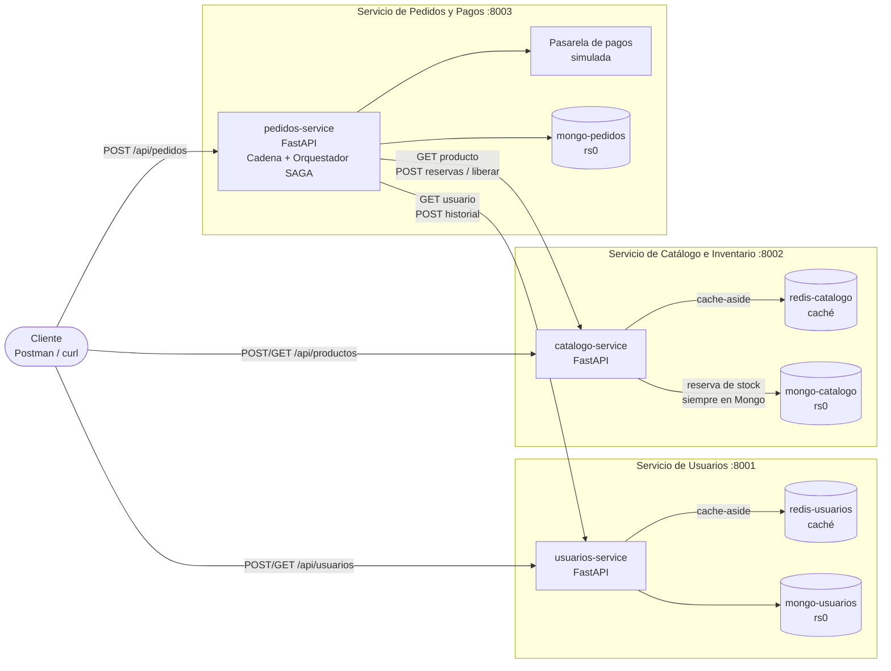
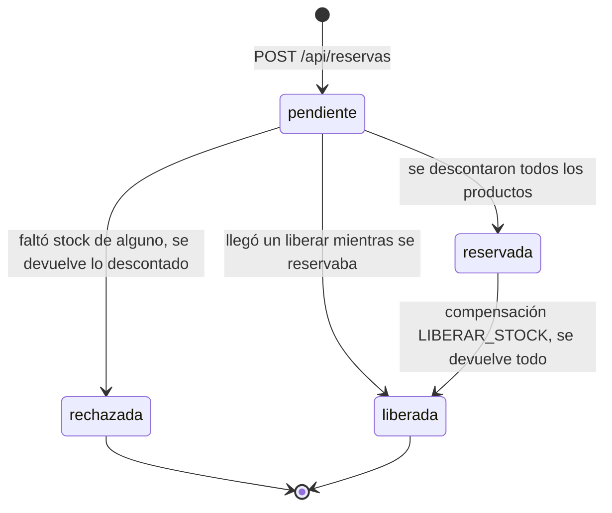
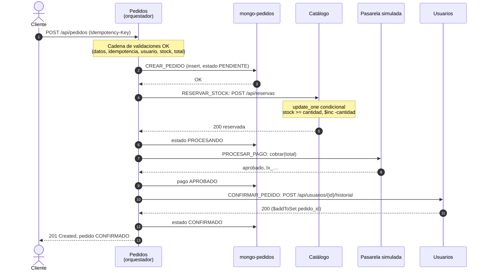
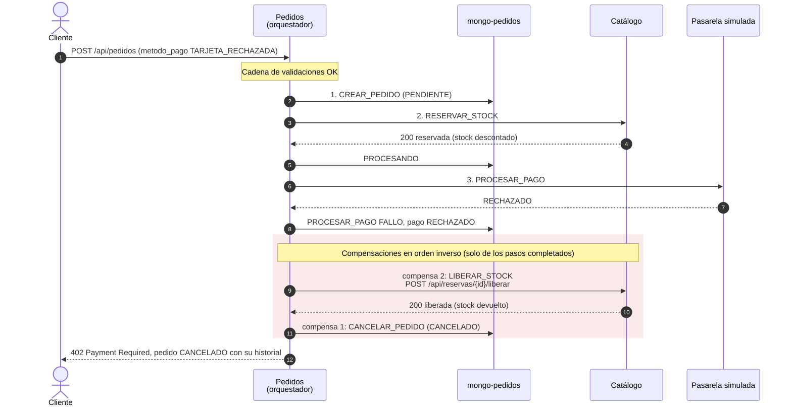

# ShopExpress — Tarea 2, Taller NoSQL 2026

Sistema de microservicios para una plataforma ficticia de comercio electrónico.
Tres servicios en Python (FastAPI), cada uno con su propia base de datos, levantados con Docker Compose.

| Servicio | Puerto | Qué hace | Base de datos | Caché |
|---|---|---|---|---|
| `usuarios-service` | 8001 | Perfiles, direcciones de envío e historial de compras | MongoDB `mongo-usuarios` | Redis `redis-usuarios` |
| `catalogo-service` | 8002 | Productos, categorías, precios y stock | MongoDB `mongo-catalogo` | Redis `redis-catalogo` |
| `pedidos-service` | 8003 | Pedidos y pagos: orquesta la SAGA y corre la Chain of Responsibility | MongoDB `mongo-pedidos` | — |

## Contenido

1. [Cómo levantar y probar](#1-cómo-levantar-y-probar)
2. [Arquitectura](#2-arquitectura)
3. [Justificación del diseño](#3-justificación-del-diseño)
4. [Patrón SAGA (orquestación)](#4-patrón-saga-orquestación)
5. [Patrón Chain of Responsibility](#5-patrón-chain-of-responsibility)
6. [Endpoints con ejemplos](#6-endpoints-con-ejemplos)
7. [Pruebas](#7-pruebas)
8. [Event Sourcing, CQRS y privacidad](#8-event-sourcing-cqrs-y-privacidad)
9. [Limitaciones conocidas](#9-limitaciones-conocidas)
10. [Estructura del repositorio](#10-estructura-del-repositorio)
11. [Uso de IA](#11-uso-de-ia)

---

## 1. Cómo levantar y probar

Requisitos: Docker con Docker Compose. Para las pruebas, Python 3.12+ y Node.js (para `newman`).

```bash
# Construir y levantar todo; --wait espera a que los 8 contenedores estén sanos
docker compose up --build -d --wait

# Verificar que cada servicio responde (y que su Mongo es PRIMARY del replica set)
curl localhost:8001/health
curl localhost:8002/health
curl localhost:8003/health

# Ver los logs de un servicio
docker compose logs -f pedidos-service

# Bajar todo y borrar los datos
docker compose down -v
```

Cada servicio publica su documentación interactiva (Swagger) en `/docs`:
[localhost:8001/docs](http://localhost:8001/docs), [localhost:8002/docs](http://localhost:8002/docs),
[localhost:8003/docs](http://localhost:8003/docs).

### Probar

```bash
# 1. Colección de Postman: todos los casos en orden, guardando los ids en variables
npx newman run postman/ShopExpress.postman_collection.json

# 2. Tests con pytest (HTTP contra los servicios levantados + unitarios sin docker)
pip install -r servicios/usuarios/tests/requirements.txt -r servicios/pedidos/tests/requirements.txt
pytest servicios

# 3. Concurrencia: 20 pedidos a la vez por un producto con stock 5 → exactamente 5 confirmados
python scripts/prueba_concurrencia.py
python scripts/demo_sobreventa.py      # lo mismo, directo contra catálogo, con 200 compradores
```

La colección también se puede importar en la app de Postman (*Import* → el archivo `.json`) y correr con *Run collection*.
Detalle de cada prueba en la [sección 7](#7-pruebas).

### Conectarse a las bases

| Base | URL desde la máquina local |
|---|---|
| Mongo de usuarios | `mongodb://localhost:27017/?directConnection=true` |
| Mongo de catálogo | `mongodb://localhost:27018/?directConnection=true` |
| Mongo de pedidos | `mongodb://localhost:27019/?directConnection=true` |

`directConnection=true` es necesario: el replica set se anuncia con el hostname interno de Docker
(`mongo-usuarios:27017`), que no existe fuera de la red de Compose.

---

## 2. Arquitectura



- **Una base por servicio.** Ningún servicio lee ni escribe en la base de otro: se comunican solo por HTTP.
  Cada uno tiene su propio contenedor de Mongo (y de Redis) para que esa separación se vea en el `docker-compose.yml`.
- **Pedidos es el orquestador.** Es el único que llama a los otros dos. Usuarios y catálogo no se conocen entre sí.
- **Cada Mongo corre como replica set de un nodo (`rs0`).** Eso habilita `writeConcern: majority`, `readConcern: majority`
  y las transacciones multi-documento. El healthcheck de cada contenedor inicializa el replica set la primera vez que arranca.
- **Capas dentro de cada servicio:** `routers` (HTTP) → `servicio` (lógica y caché) → `repositorio` (único que habla con Mongo).
  No hay código compartido entre servicios: cada uno se construye y despliega solo.

---

## 3. Justificación del diseño

### 3.1 Tecnologías: MongoDB + Redis

La letra pide al menos dos bases NoSQL. Usamos una **documental** (MongoDB) como base principal de los tres servicios
y una **clave-valor en memoria** (Redis) como caché de lectura de usuarios y catálogo.

**MongoDB**, porque:

- Los datos del dominio son *agregados* que se leen enteros: un usuario con sus direcciones, un pedido con sus ítems y su pago.
  Un documento guarda cada agregado en una sola lectura, sin joins.
- La consistencia se configura **por operación**. Con el mismo motor, pedidos escribe y lee con `majority` (consistencia fuerte)
  y catálogo descuenta stock con una operación atómica condicional (`update_one` con filtro `stock >= cantidad`).
- Tiene transacciones multi-documento sobre replica set. Las usamos en pedidos para guardar el pedido y su evento juntos.
- Los índices únicos (`email`, documento, `idempotency_key`) resuelven la unicidad de forma atómica, sin "leer y después escribir".

**Redis**, porque:

- Las lecturas de catálogo y usuarios tienen que ser "extremadamente rápidas y escalables". Redis responde desde memoria,
  y el TTL nativo (`SET … EX`) es exactamente el mecanismo de consistencia eventual que buscamos.
- Está configurado solo como caché: sin persistencia en disco y con desalojo LRU (`allkeys-lru`, 64 MB).
- **No es imprescindible.** Si Redis se cae, la caché devuelve "no está" y el servicio sigue respondiendo desde Mongo.
  Se pierde velocidad, no disponibilidad.

Patrón **cache-aside**: en un `GET` se busca primero en Redis (`usuario:{id}`, `producto:{id}`). Si no está, se lee de Mongo
y se guarda con TTL (60 s usuarios, 30 s catálogo). Cada escritura invalida la clave. Las respuestas llevan el header
`X-Cache: HIT|MISS` para poder verlo en la demo.

### 3.2 Consistencia y CAP por servicio

| Operación | Prioridad (CAP) | Cómo se logra |
|---|---|---|
| Leer usuarios y productos | **AP**: disponibilidad, consistencia eventual | Redis cache-aside con TTL. Un dato puede tener hasta 30–60 s de atraso. Si Redis falla, se lee de Mongo. |
| Escribir pedidos y pagos | **CP**: consistencia sobre velocidad | `w=majority` y `readConcern=majority`, sin caché. Pedido y evento en una misma transacción. |
| Descontar stock | **CP** | Operación atómica condicional en Mongo. **Nunca** se mira la caché para decidir si hay stock. |
| Unicidad del pedido | **CP** | Índice único sobre `idempotency_key`. |

Un ejemplo concreto: `GET /api/productos/{id}` puede mostrar un stock cacheado algo viejo. Es aceptable, porque es informativo.
Pero al comprar, la decisión de si hay stock se toma siempre contra Mongo.

En la demo cada replica set tiene un solo nodo, así que `majority` es ese nodo. En producción serían tres nodos por base y
el mismo código pasaría a tolerar la caída de uno sin perder escrituras confirmadas.

### 3.3 Modelado: embebido vs. referencia

| Dato | Decisión | Por qué |
|---|---|---|
| Direcciones del usuario | **Embebidas** en el usuario | Se leen siempre junto con el usuario, son pocas y no tienen sentido solas. |
| Historial de compras del usuario | **Referencias**: lista de `pedido_id` | Los pedidos viven en otra base (la de pedidos). Embeber el pedido entero duplicaría datos que cambian (estado, pago). Se agrega con `$addToSet` para que un reintento no duplique el id. |
| Categoría del producto | **Embebida** como texto | No tiene datos propios. Se filtra y se muestra junto con el producto. |
| Ítems del pedido | **Embebidos** en el pedido, con **referencia** a `producto_id` | El ítem es parte del pedido. El producto está en otro servicio, así que se referencia por id. |
| Precio de cada ítem | **Copia** (`precio_unitario`) | Es una foto del precio al momento de comprar: si después cambia el precio en catálogo, el pedido no cambia. |
| Pago del pedido | **Embebido** en el pedido | Relación 1 a 1 que siempre se lee y escribe junto con el pedido. |
| Usuario del pedido | **Referencia** (`usuario_id`) | Vive en otro servicio. |
| Pasos de la saga | **Embebidos** (`historial`) + colección aparte **`eventos`** | El historial se devuelve con el pedido. Los eventos son un registro que solo se agrega (ver [sección 8](#8-event-sourcing-cqrs-y-privacidad)). |

Los IDs son strings con prefijo, como en el anexo de la letra: `usr_…`, `prod_…`, `ord_…`, `tx_…`, `evt_…`.

Ejemplos de documentos guardados:

```jsonc
// usuarios.usuarios
{ "_id": "usr_9369df97f1b3", "tipo_documento": "DNI", "nro_documento": "93749055",
  "nombre": "Juan", "apellido": "Pérez", "email": "juan.perez@example.com",
  "direcciones": [ { "calle": "Av. Principal 123", "ciudad": "Montevideo", "codigo_postal": "11000" } ],
  "historial_pedidos": [ "ord_7eecb86d4e9c" ] }

// catalogo.productos
{ "_id": "prod_192d47151904", "nombre": "Auriculares inalámbricos",
  "descripcion": "Bluetooth 5.3, 30 horas de batería", "categoria": "Electrónica",
  "precio": 25.5, "stock": 8 }

// pedidos.pedidos
{ "_id": "ord_7eecb86d4e9c", "usuario_id": "usr_9369df97f1b3", "estado": "CONFIRMADO",
  "items": [ { "producto_id": "prod_192d47151904", "cantidad": 2, "precio_unitario": 25.5 } ],
  "total": 51.0,
  "pago": { "metodo": "TARJETA_CREDITO", "estado_pago": "APROBADO", "transaccion_id": "tx_8d98065b7097" },
  "idempotency_key": "compra-7f3a9c",
  "historial": [ { "paso": "CREAR_PEDIDO", "resultado": "OK", "detalle": "…", "fecha": "…" }, "…" ] }
```

Índices:

| Base | Índice | Para qué |
|---|---|---|
| usuarios | `email` único | No puede haber dos cuentas con el mismo email (se guarda en minúsculas). |
| usuarios | (`tipo_documento`, `nro_documento`) único | Ni dos con el mismo documento. |
| pedidos | `idempotency_key` único (parcial) | Un pedido por clave: ver [3.5](#35-un-pedido-tiene-que-ser-único). |
| pedidos | (`pedido_id`, `secuencia`) único en `eventos` | Orden de los eventos y que no se repita un número. |

### 3.4 Cómo evitamos la sobreventa

La regla central es que **el stock nunca se decide desde la caché**. Hay dos controles:

1. **Control previo (en la cadena).** `ValidadorDeStock` le pregunta a catálogo por cada producto y rechaza con 409 si
   claramente no alcanza. Es para responder rápido y no arrancar una saga que va a fallar.
   **No garantiza nada:** puede leer de la caché, y entre la consulta y la compra otro pedido puede llevarse el stock.

2. **La garantía (en la saga).** El paso `RESERVAR_STOCK` llama a `POST /api/reservas` de catálogo, que descuenta así:

   ```python
   update_one(
       {"_id": producto_id, "stock": {"$gte": cantidad}},   # condición...
       {"$inc": {"stock": -cantidad}},                       # ...y descuento en la MISMA operación
   )
   # modified_count == 0  →  no había stock suficiente
   ```

   La condición y el descuento son una sola operación, que Mongo aplica de forma atómica sobre el documento.
   Si llegan 100 compras a la vez por la última unidad, solo una encuentra `stock >= 1`. Para las demás el filtro ya no
   coincide y no se modifica nada. Lo que **no** hacemos es leer el stock, comparar en Python y después escribir:
   entre esos dos pasos otro request podría llevarse la misma unidad.

**Pedidos con varios productos: todos o ninguno.** Catálogo guarda una **reserva** por pedido (colección `reservas`,
`_id = pedido_id`) y va anotando en `descontados` cada producto que logró descontar. Si un producto no tiene stock,
la reserva pasa a `rechazada` y se devuelve exactamente lo que estaba anotado.



Por qué así y no con una transacción multi-documento: con muchas compras a la vez sobre el mismo producto, las transacciones
chocan entre sí (`WriteConflict`) y hay que reintentarlas. El update condicional resuelve la carrera en una sola operación.
Los cambios de estado de la reserva también son condicionales (`find_one_and_update` con filtro por estado), así que si dos
requests intentan cerrar la misma reserva, solo uno lo logra y es el único que devuelve stock. Nunca se devuelve dos veces.

Además, reservar y liberar son **idempotentes** por `pedido_id`: un reintento de la saga no descuenta ni devuelve de más.
Si el "liberar" llega antes que el "reservar" (por un timeout), queda asentada una reserva `liberada` vacía y el
"reservar" que llega después no descuenta.

Lo comprueban `scripts/prueba_concurrencia.py` y `scripts/demo_sobreventa.py` (ver [sección 7](#7-pruebas)).

### 3.5 Un pedido tiene que ser único

`POST /api/pedidos` exige el header **`Idempotency-Key`**: un id que el cliente genera una vez por compra.
Si el mismo request llega dos veces (doble clic, reintento por timeout):

| Caso | Respuesta |
|---|---|
| Falta el header | `400` |
| Ya hay un pedido terminado con esa clave y el mismo contenido | `200` con **ese** pedido. No se crea otro ni se cobra de nuevo. |
| Ya hay un pedido con esa clave, pero todavía corriendo la saga | `409` |
| La clave ya se usó con otro contenido (otro usuario, productos o método de pago) | `422` |

`ValidadorDeIdempotencia` busca la clave para responder rápido, pero la garantía la da el **índice único**. Si dos requests
iguales llegan al mismo tiempo y los dos pasan el validador sin ver nada, solo uno logra insertar el pedido. El insert del
otro choca con el índice antes de reservar stock o cobrar, e `IniciadorDeSaga` devuelve el pedido del primero.

---

## 4. Patrón SAGA (orquestación)

El servicio de pedidos es el **orquestador central** ([`app/saga.py`](servicios/pedidos/app/saga.py)). Ejecuta los pasos en
orden y, si uno falla, ejecuta las **compensaciones de los pasos ya completados, en orden inverso**.
El estado de la saga se guarda en el propio pedido (`estado` + `historial`), así siempre se puede ver qué pasó y dónde falló.

| # | Paso | Servicio | Qué hace | Compensación |
|---|---|---|---|---|
| 1 | `CREAR_PEDIDO` | pedidos | Inserta el pedido `PENDIENTE` (el índice único frena los duplicados) | `CANCELAR_PEDIDO` → estado `CANCELADO` |
| 2 | `RESERVAR_STOCK` | catálogo | `POST /api/reservas`: descuento atómico de todos los productos → `PROCESANDO` | `LIBERAR_STOCK` → `POST /api/reservas/{id}/liberar` |
| 3 | `PROCESAR_PAGO` | pedidos (pasarela simulada) | Cobra el total → pago `APROBADO` con `tx_…` | `REEMBOLSAR_PAGO` → pago `REEMBOLSADO` |
| 4 | `CONFIRMAR_PEDIDO` | usuarios | `POST /api/usuarios/{id}/historial` (agrega el pedido) → `CONFIRMADO` | — (es el último: si sale bien, terminó) |

Estados del pedido: `PENDIENTE` → `PROCESANDO` → `CONFIRMADO` | `CANCELADO`.

Las validaciones previas (datos, usuario existente, stock disponible, total) no son pasos de la saga porque no cambian nada
en ningún servicio: las hace la cadena antes de que la saga arranque (ver [sección 5](#5-patrón-chain-of-responsibility)).

Detalles de la implementación:

- **Pago simulado.** No hay pasarela real. Rechaza el método `TARJETA_RECHAZADA` y cualquier monto mayor a `LIMITE_PAGO`
  (5000), para poder mostrar las compensaciones en la demo.
- **Pasos inciertos.** Si catálogo no responde al reservar (timeout), no sabemos si llegó a descontar. En ese caso también
  se compensa ese paso (`LIBERAR_STOCK`) por las dudas, y como liberar es idempotente, no hay riesgo de devolver de más.
- **Las compensaciones se reintentan** (3 intentos) si el otro servicio no responde. Si una falla igual, queda registrada
  como `FALLO` y se siguen ejecutando las demás.
- **Código HTTP según el paso que falló:** `409` sin stock, `402` pago rechazado, `503` servicio caído, `500` error inesperado.
  En todos los casos el body trae el pedido `CANCELADO` con su historial.

### Caso exitoso



### Caso con compensación (pago rechazado)



La regla general: si falla el paso N, se compensan N-1, …, 1. Por ejemplo, si usuarios se cae en el paso 4, el historial queda
`… CONFIRMAR_PEDIDO FALLO → REEMBOLSAR_PAGO → LIBERAR_STOCK → CANCELAR_PEDIDO`.


(Cuando la reserva responde "sin stock", catálogo ya devolvió lo que había descontado, así que solo se cancela el pedido.)

---

## 5. Patrón Chain of Responsibility

La solicitud de `POST /api/pedidos` pasa por una cadena de manejadores ([`app/cadena/`](servicios/pedidos/app/cadena/)).
Cada uno hace una sola verificación o cálculo y, si sale bien, le pasa el contexto al siguiente. Si algo falla, lanza
`ErrorDePedido` y la cadena se corta ahí: los siguientes no se ejecutan. Un manejador también puede **terminar** la cadena
con una respuesta, como hace `ValidadorDeIdempotencia` cuando el pedido ya existe.


| Manejador | Responsabilidad | Corta con |
|---|---|---|
| `ValidadorDeDatos` | Valida el body con Pydantic: `usuario_id`, `items` (≥ 1, cantidad > 0), `metodo_pago`. Junta productos repetidos. | `422` |
| `ValidadorDeIdempotencia` | Exige `Idempotency-Key`. Si ya hay un pedido con esa clave, lo devuelve y termina la cadena. | `400`, `409`, `422`, o termina con `200` |
| `ValidadorDeUsuario` | Pregunta a usuarios si el usuario existe. | `404`, `503` |
| `ValidadorDeStock` | Pregunta a catálogo por todos los productos en paralelo: que existan y que alcance el stock. | `404`, `409`, `503` |
| `CalculadorDeTotal` | Arma las líneas y el total con los **precios del catálogo** (nunca los del cliente), con `Decimal` para evitar errores de redondeo. | — |
| `IniciadorDeSaga` | Último eslabón: crea el pedido y corre la saga. | — (si la saga falla, devuelve el pedido `CANCELADO`) |

Decisiones:

- **Idempotencia va segunda**, antes de usuario y stock: un pedido repetido se resuelve sin volver a consultar a otros servicios.
- **Orden de lo más barato a lo más caro**: validar el body no hace I/O; las validaciones siguientes sí. El primer error corta.
- **Relación con la SAGA**: la cadena decide *si* el pedido puede intentarse; la saga ejecuta *los cambios* y sabe deshacerlos.
  Por eso los manejadores no modifican nada en otros servicios (solo leen), y el pago no es un manejador: es un paso
  de la saga porque necesita compensación (el reembolso). La letra menciona `ProcesadorDePago` como manejador posible;
  nosotros lo pusimos dentro de la saga por esa razón.
- La clase base [`Manejador`](servicios/pedidos/app/cadena/base.py) tiene `enlazar()` y `manejar(contexto)`. Lo que cada
  manejador calcula viaja en un `ContextoPedido`. Los manejadores no guardan estado, así que la cadena se arma una sola vez.

---

## 6. Endpoints con ejemplos

Todos los servicios exponen `GET /health`, que también informa si su Mongo es PRIMARY del replica set (y si Redis responde):

```json
{ "servicio": "catalogo", "estado": "ok", "mongo": { "ok": true, "replica_set": "rs0", "primario": true }, "redis": { "ok": true } }
```

### Usuarios (`localhost:8001`)

#### `POST /api/usuarios` — crear usuario

```bash
curl -X POST localhost:8001/api/usuarios -H "Content-Type: application/json" -d '{
  "tipo_documento": "DNI",
  "nro_documento": "12345678",
  "nombre": "Juan",
  "apellido": "Pérez",
  "email": "juan.perez@example.com",
  "direcciones": [ { "calle": "Av. Principal 123", "ciudad": "Montevideo", "codigo_postal": "11000" } ]
}'
```

`201 Created`

```json
{
  "id": "usr_9369df97f1b3",
  "tipo_documento": "DNI",
  "nro_documento": "12345678",
  "nombre": "Juan",
  "apellido": "Pérez",
  "email": "juan.perez@example.com",
  "direcciones": [ { "calle": "Av. Principal 123", "ciudad": "Montevideo", "codigo_postal": "11000" } ],
  "historial_pedidos": []
}
```

Errores: `409` email o documento ya registrado (`"Ya existe un usuario con ese email"`), `422` datos inválidos.

#### `GET /api/usuarios/{usuario_id}` — obtener usuario

```bash
curl -i localhost:8001/api/usuarios/usr_9369df97f1b3
```

`200 OK` con el usuario, header `X-Cache: MISS` la primera vez y `X-Cache: HIT` las siguientes (hasta que vence el TTL
o cambia el usuario). Después de una compra, `historial_pedidos` trae los ids: `["ord_7eecb86d4e9c"]`.
Error: `404` `"Usuario no encontrado"`.

#### `GET /api/usuarios/exportar?formato=json|csv` — exportación seudonimizada (opcional de la letra)

```bash
curl localhost:8001/api/usuarios/exportar
curl -OJ "localhost:8001/api/usuarios/exportar?formato=csv"    # descarga usuarios.csv
```

`200 OK`

```json
[
  {
    "tipo_documento": "DNI",
    "documento_hash": "97340b8e6c331ef12f5198fbfbffc881a7f6ff7a70430432dd12ffd0adf34d16",
    "email_hash": "1437be8c37ddba4335c050f2bdd509c5a2b8dd5e7a3016da7b028a9e1fc725b4",
    "nombre": "J.",
    "apellido": "P.",
    "direcciones": [ { "ciudad": "Montevideo", "codigo_postal": "11000" } ],
    "cantidad_pedidos": 1
  }
]
```

```csv
tipo_documento,documento_hash,email_hash,nombre,apellido,direcciones,cantidad_pedidos
DNI,9d1e9d2f…,0f444125…,J.,P.,Montevideo (11000),1
```

Error: `422` si `formato` no es `json` ni `csv`. Qué se hace con cada dato: [sección 8](#8-event-sourcing-cqrs-y-privacidad).

#### `POST /api/usuarios/{usuario_id}/historial` — interno (lo usa la saga)

```json
{ "pedido_id": "ord_7eecb86d4e9c" }
```

`200` con el usuario actualizado. Usa `$addToSet`, así que repetirlo no duplica el id, e invalida `usuario:{id}` en Redis.
`404` si el usuario no existe.

### Catálogo e Inventario (`localhost:8002`)

#### `POST /api/productos` — crear producto

```bash
curl -X POST localhost:8002/api/productos -H "Content-Type: application/json" -d '{
  "nombre": "Auriculares inalámbricos",
  "descripcion": "Bluetooth 5.3, 30 horas de batería",
  "categoria": "Electrónica",
  "precio": 25.5,
  "stock": 10
}'
```

`201 Created`

```json
{
  "id": "prod_192d47151904",
  "nombre": "Auriculares inalámbricos",
  "descripcion": "Bluetooth 5.3, 30 horas de batería",
  "categoria": "Electrónica",
  "precio": 25.5,
  "stock": 10
}
```

Error: `422` (por ejemplo precio ≤ 0 o stock negativo).

#### `GET /api/productos/{producto_id}` — obtener producto y su stock

```bash
curl -i localhost:8002/api/productos/prod_192d47151904
```

`200 OK` con el producto y `X-Cache: HIT|MISS`. El stock que muestra puede estar cacheado (hasta 30 s): es informativo.
Error: `404` `"Producto no encontrado"`.

#### `POST /api/reservas` y `POST /api/reservas/{pedido_id}/liberar` — internos (los usa la saga)

```json
// POST /api/reservas
{ "pedido_id": "ord_7eecb86d4e9c", "items": [ { "producto_id": "prod_192d47151904", "cantidad": 2 } ] }
```

`200` si quedó reservado, `409` si no (el body dice el motivo):

```json
{ "pedido_id": "ord_7eecb86d4e9c", "estado": "reservada",
  "items": [ { "producto_id": "prod_192d47151904", "cantidad": 2 } ],
  "descontados": [ "prod_192d47151904" ], "motivo": null }
```

`liberar` responde siempre `200`: la reserva queda `liberada` (vacía, si nunca se había reservado) o sigue `rechazada`
si la reserva ya había fallado por falta de stock.
Los dos se pueden repetir con el mismo `pedido_id` sin descontar ni devolver de más.

### Pedidos y Pagos (`localhost:8003`)

#### `POST /api/pedidos` — inicia la Chain of Responsibility y la SAGA

```bash
curl -X POST localhost:8003/api/pedidos \
  -H "Content-Type: application/json" \
  -H "Idempotency-Key: compra-7f3a9c" \
  -d '{
    "usuario_id": "usr_9369df97f1b3",
    "items": [ { "producto_id": "prod_192d47151904", "cantidad": 2 } ],
    "metodo_pago": "TARJETA_CREDITO"
  }'
```

`metodo_pago`: `TARJETA_CREDITO`, `TARJETA_DEBITO`, `TRANSFERENCIA` o `TARJETA_RECHAZADA` (siempre rechazado, para la demo).
El cliente no manda precios ni total: los calcula pedidos con los precios del catálogo.

`201 Created`, pedido confirmado:

```json
{
  "pedido_id": "ord_7eecb86d4e9c",
  "usuario_id": "usr_9369df97f1b3",
  "estado": "CONFIRMADO",
  "items": [ { "producto_id": "prod_192d47151904", "cantidad": 2, "precio_unitario": 25.5 } ],
  "total": 51.0,
  "pago": { "metodo": "TARJETA_CREDITO", "estado_pago": "APROBADO", "transaccion_id": "tx_8d98065b7097" },
  "idempotency_key": "compra-7f3a9c",
  "historial": [
    { "paso": "CREAR_PEDIDO",     "resultado": "OK", "detalle": "Pedido creado como PENDIENTE", "fecha": "2026-11-03T23:37:35.570Z" },
    { "paso": "RESERVAR_STOCK",   "resultado": "OK", "detalle": "Stock reservado en catálogo", "fecha": "2026-11-03T23:37:35.585Z" },
    { "paso": "PROCESAR_PAGO",    "resultado": "OK", "detalle": "Pago aprobado, transacción tx_8d98065b7097", "fecha": "2026-11-03T23:37:35.590Z" },
    { "paso": "CONFIRMAR_PEDIDO", "resultado": "OK", "detalle": "Pedido confirmado y agregado al historial del usuario", "fecha": "2026-11-03T23:37:35.601Z" }
  ]
}
```

`402 Payment Required`, pago rechazado y saga compensada (`"metodo_pago": "TARJETA_RECHAZADA"`):

```json
{
  "pedido_id": "ord_185b4521720c",
  "estado": "CANCELADO",
  "total": 76.5,
  "pago": { "metodo": "TARJETA_RECHAZADA", "estado_pago": "RECHAZADO", "transaccion_id": null },
  "historial": [
    { "paso": "CREAR_PEDIDO",    "resultado": "OK",    "detalle": "Pedido creado como PENDIENTE" },
    { "paso": "RESERVAR_STOCK",  "resultado": "OK",    "detalle": "Stock reservado en catálogo" },
    { "paso": "PROCESAR_PAGO",   "resultado": "FALLO", "detalle": "La tarjeta fue rechazada por el emisor" },
    { "paso": "LIBERAR_STOCK",   "resultado": "OK",    "detalle": "Stock devuelto al catálogo" },
    { "paso": "CANCELAR_PEDIDO", "resultado": "OK",    "detalle": "Pedido cancelado" }
  ]
}
```

Todas las respuestas posibles:

| Código | Cuándo | Body |
|---|---|---|
| `201` | Saga completa | Pedido `CONFIRMADO` |
| `200` | Misma `Idempotency-Key` y mismo contenido que un pedido ya terminado | El pedido existente |
| `400` | Falta `Idempotency-Key` | `"Falta el header Idempotency-Key"` |
| `404` | No existe el usuario o algún producto | `"No existe el usuario usr_…"` |
| `409` | Sin stock (en la cadena) | `"Stock insuficiente de prod_…: hay 8, se pidieron 50"` |
| `409` | Sin stock al reservar (otro pedido se lo llevó), o la misma clave todavía en proceso | Pedido `CANCELADO` / mensaje |
| `402` | Pago rechazado | Pedido `CANCELADO` con compensaciones |
| `422` | Body inválido, o la clave ya se usó con otro contenido | Detalle del error |
| `503` | Usuarios o catálogo no responden | Mensaje, o pedido `CANCELADO` si ya había arrancado la saga |

#### `GET /api/pedidos/{pedido_id}` — ver un pedido y el estado de su saga

`200` con el pedido (mismo formato que arriba), siempre leído de Mongo, sin caché. `404` si no existe.

#### `GET /api/pedidos/{pedido_id}/eventos` — eventos de la saga, en orden

```json
[
  { "evento_id": "evt_a4964b6a9548", "secuencia": 1, "paso": "CREAR_PEDIDO", "resultado": "OK",
    "cambios": [ { "campo": "estado", "valor": "PENDIENTE" }, { "campo": "total", "valor": 76.5 }, "…" ] },
  { "evento_id": "evt_ae84f331e2b3", "secuencia": 2, "paso": "RESERVAR_STOCK", "resultado": "OK",
    "cambios": [ { "campo": "estado", "valor": "PROCESANDO" } ] },
  { "evento_id": "evt_0ee5133d4ece", "secuencia": 3, "paso": "PROCESAR_PAGO", "resultado": "FALLO",
    "cambios": [ { "campo": "pago.estado_pago", "valor": "RECHAZADO" } ] },
  { "evento_id": "evt_2c6a9463d7f4", "secuencia": 4, "paso": "LIBERAR_STOCK", "resultado": "OK", "cambios": [] },
  { "evento_id": "evt_6c64dede6600", "secuencia": 5, "paso": "CANCELAR_PEDIDO", "resultado": "OK",
    "cambios": [ { "campo": "estado", "valor": "CANCELADO" } ] }
]
```

---

## 7. Pruebas

Todas se corren con los servicios levantados (`docker compose up --build -d --wait`), salvo los unitarios.

### Colección de Postman

[`postman/ShopExpress.postman_collection.json`](postman/ShopExpress.postman_collection.json). Cada request guarda en variables
de la colección los ids que necesita el siguiente, así que se corre de corrido y se puede repetir: el email y el documento
se generan al azar en cada corrida.

| # | Request | Qué verifica |
|---|---|---|
| 1 | Crear usuario | `201`, id `usr_…`, direcciones embebidas, historial vacío |
| 2.1 | Crear producto (stock 10) | `201`, id `prod_…` |
| 2.2 | Crear producto (stock 2) | `201` (es el que se usa para "sin stock") |
| 3 | Consultar producto | `200`, stock, header `X-Cache` |
| 4 | Pedido OK | `201`, `CONFIRMADO`, pago `APROBADO`, total con el precio del catálogo, los 4 pasos de la saga |
| 5 | Pedido sin stock | `409`, lo corta `ValidadorDeStock` |
| 6 | Pedido con pago rechazado | `402`, `CANCELADO`, compensaciones `LIBERAR_STOCK` y `CANCELAR_PEDIDO` en orden inverso |
| 7 | Ver el stock después del rechazo | El stock bajó solo por el pedido OK: el del rechazado se devolvió |
| 8.1 | Exportar usuarios (JSON) | Iniciales, hash HMAC del email, sin datos reales |
| 8.2 | Exportar usuarios (CSV) | `text/csv`, se descarga como `usuarios.csv` |

```bash
npx newman run postman/ShopExpress.postman_collection.json
```

### Tests con pytest

```bash
pip install -r servicios/usuarios/tests/requirements.txt -r servicios/pedidos/tests/requirements.txt
pytest servicios                              # todo
pytest servicios/pedidos/tests/unitarios      # solo los unitarios: no necesitan docker
```

- **HTTP** (`servicios/*/tests/test_*.py`): contra los servicios levantados. Usuarios (unicidad, caché, exportación),
  catálogo (reservas, sin stock, idempotencia de reservar y liberar) y pedidos (camino feliz, sin stock, pago rechazado
  con liberación de stock, pedido duplicado, eventos).
- **Unitarios de la cadena y la saga** (`servicios/pedidos/tests/unitarios/`): Mongo, usuarios y catálogo se reemplazan por
  versiones falsas en memoria. Así se prueban casos que desde afuera no se pueden provocar: un servicio que se cae a mitad
  de la saga, un timeout al reservar, una compensación que falla y se reintenta, el orden de los manejadores.

### Concurrencia y sobreventa

```bash
python scripts/prueba_concurrencia.py                       # stock 5, 20 pedidos a la vez
python scripts/prueba_concurrencia.py --stock 5 --pedidos 50
python scripts/demo_sobreventa.py --stock 3 --compradores 500
```

- `prueba_concurrencia.py` pasa por todo el sistema (`POST /api/pedidos`). Con stock 5 y 20 pedidos simultáneos tienen que
  confirmarse **exactamente 5**, el stock terminar en 0 (nunca negativo) y el historial del usuario tener esos 5 pedidos.
  Después manda el **mismo pedido** (misma `Idempotency-Key`) 20 veces a la vez: tiene que crearse uno solo.
- `demo_sobreventa.py` hace lo mismo directo contra `POST /api/reservas` de catálogo, con más compradores.

---

## 8. Event Sourcing, CQRS y privacidad

### Event Sourcing (implementado en parte)

Cada paso y cada compensación de la saga se guarda como **evento** en la colección `eventos` de pedidos. Los eventos
**solo se agregan**: nunca se modifican ni se borran. El pedido y su evento se escriben en **una misma transacción**, así
que nunca quedan desfasados. Cada evento lleva un número de `secuencia` y los `cambios` que produjo.

Aplicando los `cambios` de los eventos en orden de `secuencia` se reconstruye el pedido entero (el primer evento trae los
datos iniciales). Se consultan con `GET /api/pedidos/{id}/eventos`.

Hoy el documento del pedido sigue siendo la fuente de verdad y los eventos son su registro de auditoría. Para pasar a
Event Sourcing completo, el pedido se guardaría *solo* como eventos y el documento actual sería una proyección calculada a
partir de ellos. Eso permitiría, por ejemplo, ver cómo estaba un pedido en cualquier momento.

### CQRS (propuesta)

La letra separa lecturas (AP, rápidas) de escrituras (CP, consistentes), y eso es la idea de CQRS. Ya la aplicamos en parte:
las lecturas salen de Redis y las escrituras van a Mongo con `majority`. Un paso más sería:

- **Comandos:** `POST /api/pedidos` escribe eventos (como ahora).
- **Consultas:** un proceso lee los eventos y arma vistas de solo lectura optimizadas para cada pantalla, por ejemplo
  "pedidos de un usuario con el nombre de cada producto". Viven en otra base o colección y se pueden escalar aparte.
  Quedan con consistencia eventual respecto de las escrituras.

Así el historial del usuario dejaría de ser un `$addToSet` síncrono en el paso 4 de la saga: sería una proyección
alimentada por los eventos `CONFIRMAR_PEDIDO`.

### Seudonimización de datos personales (implementado)

`GET /api/usuarios/exportar` devuelve los usuarios sin datos que identifiquen a la persona
([`anonimizacion.py`](servicios/usuarios/app/anonimizacion.py)):

| Dato | Qué sale | Por qué |
|---|---|---|
| Email | `HMAC-SHA256(email, clave)` | Un SHA-256 solo no alcanza: un documento son 8 cifras y se pueden probar todas hasta dar con el hash. Sin la clave eso no se puede hacer. |
| Documento | `HMAC-SHA256("DNI:12345678", clave)` | Igual. Se hashea junto con el tipo porque la unicidad es por los dos. |
| Nombre y apellido | Solo las iniciales: `J.` `P.` | |
| Direcciones | Solo ciudad y código postal | La calle identifica a la persona. |
| Historial | Solo la cantidad de pedidos | |

El mismo dato siempre da el mismo hash, así que se pueden cruzar dos exportaciones (contar usuarios distintos, por ejemplo)
sin saber quién es quién. Es **seudonimización** y no anonimización total: quien tenga la clave `CLAVE_SEUDONIMIZACION`
puede calcular el hash de un email conocido y encontrarlo en el archivo. Por eso la clave va en una variable de entorno;
en producción saldría de un gestor de secretos, no del `docker-compose.yml`.

Otras medidas posibles: cifrar en reposo los campos sensibles (email, documento) con cifrado a nivel de campo de MongoDB
(CSFLE / Queryable Encryption), y no guardar datos personales en los logs ni en los eventos (los eventos de pedidos solo
tienen `usuario_id`, no el email ni el nombre).

---

## 9. Limitaciones conocidas

- **Si pedidos se cae a mitad de una saga, nadie la retoma.** El progreso queda guardado en Mongo, pero el pedido quedaría
  en `PENDIENTE` o `PROCESANDO`. Haría falta un proceso que busque sagas sin terminar y las compense.
- **Si catálogo se cae entre descontar un producto y anotarlo en la reserva**, esa unidad queda descontada sin estar en
  ninguna reserva. Elegimos ese orden porque el error va para el lado seguro: se puede vender de menos, nunca de más.
- **`CONFIRMAR_PEDIDO` no tiene compensación**: usuarios no permite sacar un pedido del historial. Si usuarios agrega el
  pedido pero la respuesta no llega (timeout), el historial puede mostrar un pedido que en pedidos figura `CANCELADO`.
- **Un solo nodo por replica set.** Alcanza para usar transacciones y `majority`, pero no da tolerancia a fallos real.
- **Pago simulado**: no hay pasarela real; `reembolsar` siempre funciona.

---

## 10. Estructura del repositorio

```
Tarea2-NOSQL/
├── README.md
├── CLAUDE.md                       # contexto y decisiones de diseño (ver sección 11)
├── docker-compose.yml              # 3 Mongo (replica set), 2 Redis, 3 servicios
├── docs/letra.pdf
├── postman/ShopExpress.postman_collection.json
├── scripts/
│   ├── prueba_concurrencia.py      # N pedidos en paralelo contra stock limitado
│   └── demo_sobreventa.py          # lo mismo, directo contra catálogo
└── servicios/
    ├── usuarios/                   # usuarios-service
    │   ├── Dockerfile, requirements.txt
    │   ├── app/
    │   │   ├── main.py             # FastAPI, conexiones, índices y /health
    │   │   ├── config.py, db.py, cache.py
    │   │   ├── modelos.py          # Pydantic
    │   │   ├── repositorio.py      # única capa que habla con Mongo
    │   │   ├── servicio.py         # cache-aside e invalidación
    │   │   ├── anonimizacion.py    # seudonimización para /exportar
    │   │   └── routers/            # usuarios.py (públicos), internos.py (historial)
    │   └── tests/
    ├── catalogo/                   # catalogo-service (misma estructura)
    │   └── app/servicio.py         # reservar / liberar stock sin sobreventa
    └── pedidos/                    # pedidos-service (sin Redis)
        ├── app/
        │   ├── cadena/             # base.py + un archivo por manejador
        │   ├── saga.py             # orquestador: pasos y compensaciones
        │   ├── pagos.py            # pasarela simulada
        │   ├── clientes.py         # httpx hacia usuarios y catálogo
        │   ├── repositorio.py      # pedidos + eventos (transacción)
        │   └── routers/pedidos.py
        └── tests/                  # HTTP + unitarios/ (cadena y saga, sin docker)
```

---

## 11. Uso de IA

Usamos **Claude Code** (asistente de programación con IA de Anthropic) durante el desarrollo, para escribir código, tests
y documentación. El archivo [`CLAUDE.md`](CLAUDE.md) es el contexto que le dimos: el stack, las decisiones de diseño,
las convenciones del código y el plan por etapas.
